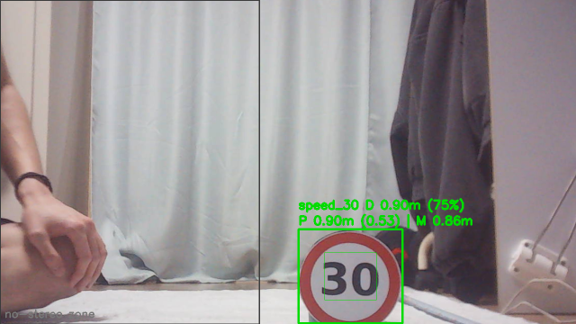
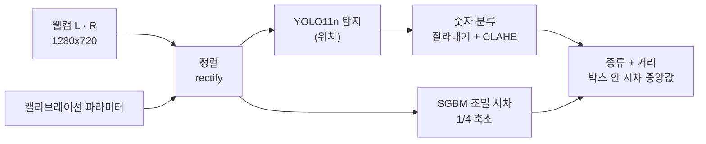
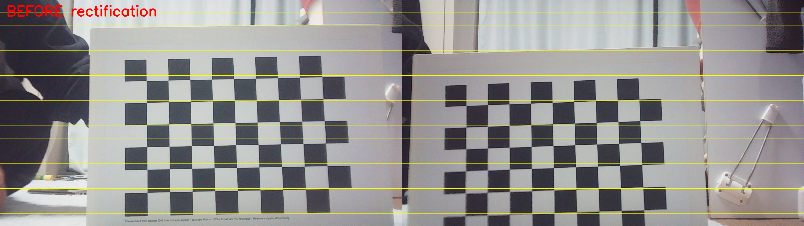
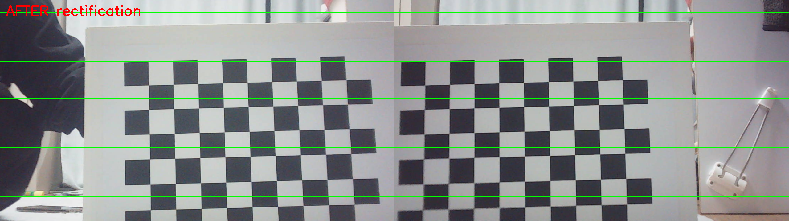
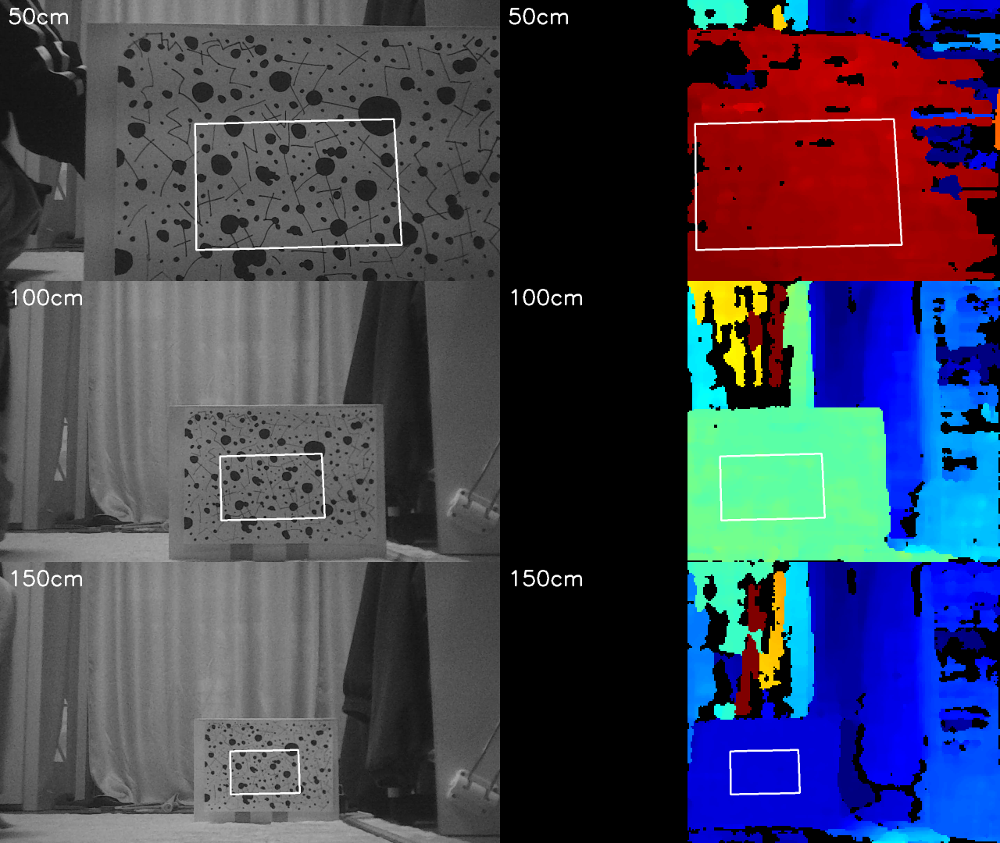
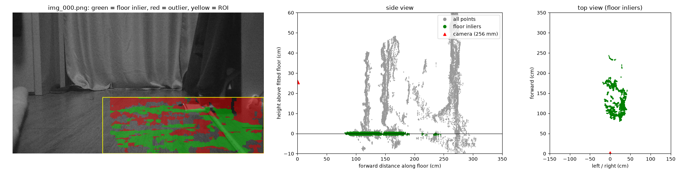
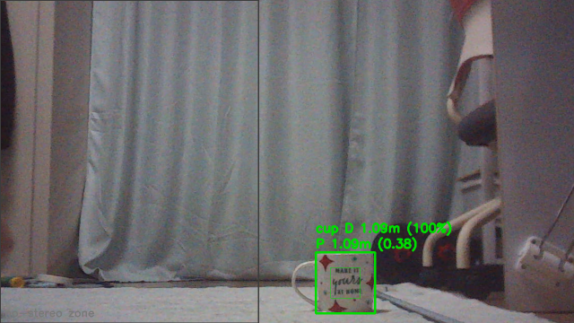
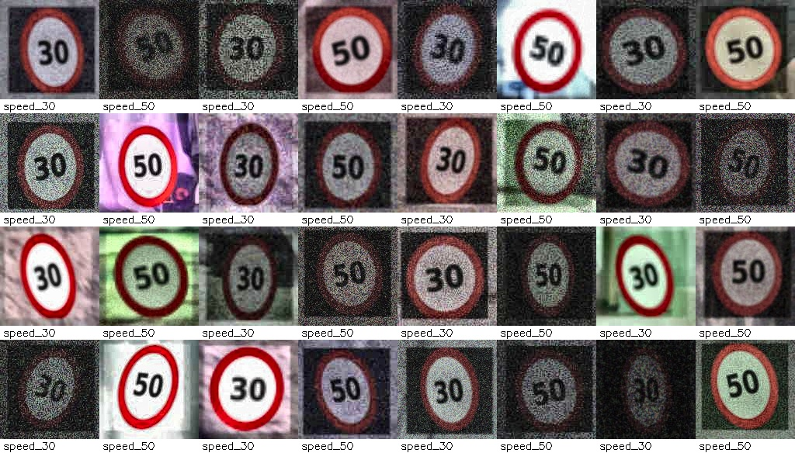
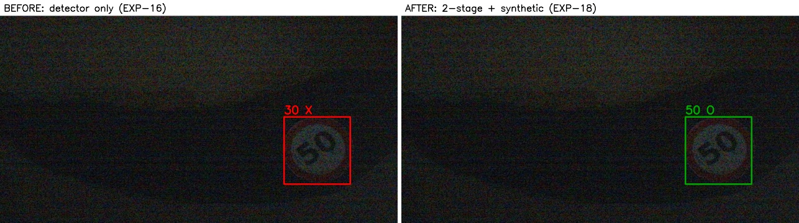

# 웹캠 2대로 만든 스테레오 인지 시스템

> 범용 웹캠 2대로 **카메라 캘리브레이션 → 스테레오 거리 측정 → 바닥 평면 추정 → 물체 탐지 + 거리 → 커스텀 표지판 인식**까지 직접 구현하고, 모든 결과를 **줄자 실측으로 검증**한 1인 프로젝트




*속도제한 표지판을 찾아 종류(30/50)와 거리를 함께 표시하는 화면. D = 스테레오 조밀 시차, P = 박스 매칭, M = 단안(크기)*

---

## 목차

1. [왜 만들었나](#왜-만들었나)
2. [핵심 결과](#핵심-결과)
3. [시스템 구조](#시스템-구조)
4. [단계별 내용](#단계별-내용)
5. [문제 해결 하이라이트](#문제-해결-하이라이트)
6. [검증 방법](#검증-방법)
7. [실행 방법](#실행-방법)
8. [한계와 다음 단계](#한계와-다음-단계)

---

## 왜 만들었나

자율주행 인지의 기본은 **"무엇이, 어디에, 얼마나 멀리"** 있는지 아는 것입니다.
라이브러리 함수를 호출하는 데서 끝내지 않고, 각 단계가 **실제로 얼마나 정확한지 숫자로 확인**하는 것을 목표로 했습니다.

- 실험 한 번에 **조건 하나만** 바꾸고, 18개 실험(EXP-1~18)을 모두 기록
- 재투영 오차 같은 내부 지표가 아니라 **줄자·자·수평계 실측**으로 판단
- 실패한 시도와 틀린 가설도 남겨서 원인을 좁혀 감

## 핵심 결과

| 단계 | 내용 | 결과 |
| --- | --- | --- |
| 단일 캘리브레이션 | 카메라별 내부 파라미터 + 렌즈 왜곡 | 거리 배율 오차 1.49% → **0.45%** |
| 스테레오 캘리브레이션 | 두 카메라 위치 관계 | 베이스라인 119.57mm (실측 120mm, **0.36%**) |
| 정렬 | rectification | 세로 어긋남 73px → **RMS 0.34px** |
| 거리 측정 | 체커보드 코너 삼각측량, 50~150cm | 최대 오차 **6.6mm (약 1%)** |
| 조밀 시차 | 화면 전체 거리 (SGBM) | 채움 0% → **98~100%**, 약 1% |
| 바닥 평면 | 포인트 클라우드 + RANSAC | 카메라 높이 +2.9%, 기울기 **0.45°** 이내 |
| 물체 거리 | YOLO + 스테레오 (컵) | 최대 **0.9%**, 약 18fps (CPU) |
| 커스텀 탐지 | 직접 만든 속도제한 표지판 데이터셋 | 새 장면 정답률 73% → **95%** |
| 표지판 거리 | 탐지 + 분류 + 스테레오 | 최대 **6.7mm (1.3%)**, 6/6 정답 |

## 시스템 구조



검출과 거리 계산을 분리해서, 탐지 모델을 바꿔도 거리 계산은 그대로 재사용했습니다.

| 하드웨어 | 사양 |
| --- | --- |
| 카메라 | 범용 USB 웹캠 2대 (같은 모델, 고정 초점), MJPG |
| 스테레오 장치 | 한 판에 고정, 베이스라인 120mm, 노출 수동 고정 |
| 체커보드 | 내부 코너 9×6, 칸 25.0mm |
| 컴퓨터 | 노트북 CPU (GPU 없음), 학습은 Google Colab T4 |

## 단계별 내용

<details>
<summary><b>1. 단일 카메라 캘리브레이션 (EXP-1~8)</b></summary>

| 실험 | 바꾼 것 | RMS | fx ± 표준편차 | 줄자 거리 오차 |
| --- | --- | --- | --- | --- |
| EXP-2 기준 | 정면 위주 15장 | 0.184px | 1413.8 ± 9.6 | −1.49% |
| EXP-3 | 기울인 사진 추가, k3 고정 | 0.331px | 1451.1 ± 2.4 | +0.88% |
| EXP-6 최종 | 흐림·과한 기울기 제거 | 0.250px | 1429.6 ± 1.4 | **−0.45%** |

- 재투영 오차가 가장 낮았던 EXP-2가 실제로는 fx가 약 1.6% 작았음 (거리 오차 −1.49%)
- 좁은 화각(48°)에서는 k2·k3를 구분할 수 없어 k3를 0으로 고정
- 같은 모델 카메라 B는 실제 fx가 1.2% 다르고 주점이 90px 아래 → 카메라마다 따로 캘리브레이션
</details>

<details>
<summary><b>2. 스테레오 캘리브레이션과 정렬 (EXP-9~11)</b></summary>

- 실시간 정렬 확인으로 두 카메라 pitch 차이를 5.2° → 0.70°로 맞춤
- 내부 파라미터는 고정하고 R, t만 계산 → 베이스라인 119.57mm (줄자 120mm)
- 정렬 전 세로 차이 평균 73px → 정렬 후 RMS 0.343px



*정렬 전 좌우 영상. 노란 가로선에서 보면 같은 코너가 좌우 영상에서 서로 다른 높이에 있음 (세로 차이 평균 73px)*



*정렬 후 좌우 영상. 초록 가로선 위에서 같은 코너가 같은 높이에 놓임 (세로 차이 RMS 0.34px)*
</details>

<details>
<summary><b>3. 거리 측정 (EXP-12~13)</b></summary>

- 오차를 **배율 s**(캘리브레이션)와 **일정 오차 b**(세팅)로 분해
- 일정하게 12mm 짧던 원인은 카메라가 줄자보다 5.5° 위를 본 것 → 보정 후 오차 평균 0.0mm, 최대 6.6mm
- 조밀 시차는 체커보드(반복 무늬)에서 실패 → 랜덤 무늬 + 1/4 축소 + 노출 고정으로 채움 98~100%



*50 / 100 / 150cm에서의 랜덤 무늬 판(왼쪽)과 시차 지도(오른쪽). 빨강 = 가까움, 파랑 = 멂, 검정 = 시차 없음, 흰 박스 = 거리를 잰 영역*
</details>

<details>
<summary><b>4. 포인트 클라우드와 바닥 평면 (EXP-14)</b></summary>

- 조밀 시차 → 3D 점 → RANSAC으로 바닥 평면 → 카메라 높이·기울기
- 높이 255.3mm (자 248mm), 기울기는 수평계로 예상한 값과 0.45° 차이
- 차량의 도로 평면 추정·카메라 pitch 보정과 같은 원리



*왼쪽: 바닥으로 판정된 점(초록)과 제외된 점(빨강), 가운데: 옆에서 본 포인트 클라우드와 카메라 높이, 오른쪽: 위에서 본 바닥 점*
</details>

<details>
<summary><b>5. YOLO + 스테레오 거리 (EXP-15)</b></summary>

- YOLO11n이 왼쪽 영상에서 물체를 찾아 박스를 침 (무엇이, 어디에)
- 박스 안에서 좌우 영상의 위치 차이(시차)를 재서 거리로 바꿈 (얼마나 멀리)
    - 가까울수록 시차가 크고 멀수록 작음 → 거리 = 초점거리 × 카메라 간격 ÷ 시차
    - 박스 가장자리는 배경이 섞이므로 가로·세로 각각 가운데 절반 영역만 사용
    - 틀린 시차 몇 개에 흔들리지 않도록 평균 대신 중앙값을 대표값으로 사용
- 컵 70~150cm 5곳 모두 성공, 최대 6mm (0.9%), CPU 약 18fps



*컵 거리 측정 화면. 바깥 박스 = YOLO 검출, 안쪽 박스 = 시차를 잰 가운데 영역, D = 조밀 시차 거리(채움 %), P = 박스 매칭 거리*
</details>

<details>
<summary><b>6. 커스텀 표지판 인식 (EXP-16~18)</b></summary>

| 시도 | 새 장면 정답률 | 결론 |
| --- | --- | --- |
| YOLO11n 파인튜닝 | 73% | 50을 30으로 읽는 혼동이 핵심 |
| 학습 설정 변경 (반전·입력 960·큰 모델) | 효과 없음 | 병목은 설정이 아니라 데이터 |
| 2단계 구조 (탐지 → 숫자 분류) | 70% | 구조를 바꿔도 같은 약점 |
| **합성 데이터 3,000장 추가** | **95%** | 부족한 조건(아주 어두운 50)을 채움 |



*코드로 만든 합성 표지판: 어둠·역광·노이즈·흐림·기울기를 무작위로 섞음*



*같은 사진, 왼쪽은 탐지기 혼자(틀림), 오른쪽은 2단계 + 합성 데이터(맞음)*

</details>

## 문제 해결 하이라이트

**1. 좋아 보이는 지표 뒤의 숨은 편향**
첫 캘리브레이션은 재투영 오차 0.18px로 좋아 보였지만 fx 표준편차가 ±9.7px로 컸습니다. 교차 검증으로도 어느 값이 맞는지 판정이 안 돼서 줄자로 이동 거리를 재는 검증을 설계했고, 기준 실험의 fx가 실제보다 약 1.6% 작아 거리가 1.49% 틀린다는 것을 찾았습니다.
- 원인 ① 보드를 정면으로만 찍어 초점거리와 거리가 구분되지 않음 → 30~45° 기울인 사진 추가 (fx 표준편차 4배 감소)
- 원인 ② 좁은 화각에서 고차 왜곡 계수(k3) 과적합 → k3 = 0으로 고정
- 원인 ③ 가까워서 흐린 사진, 58°까지 과하게 기울인 사진이 반대 방향 편향(+0.88%)을 만듦 → 선명한 거리 + 45° 이하로 재촬영
- 결과: 줄자 검증 거리 오차 1.49% → **0.45%**

**2. 조밀 시차 0% → 98%**
코너 없는 물체의 거리를 재려면 화면 전체 시차(SGBM)가 필요한데, 체커보드에서는 거의 실패했습니다. 무늬·창 크기·필터·해상도·노출을 한 번에 하나씩 바꿔 가설 7개를 검증했습니다.
- 원인 ① 반복 무늬라 여러 위치가 똑같아 보여 짝을 못 찾음 → 랜덤 점 무늬 판으로 교체
- 원인 ② 웹캠 압축 잡음 때문에 원본 해상도에서 매칭이 흔들림 → 영상을 1/4로 줄여 계산 (잡음이 평균되고 같은 창이 더 넓은 면적을 봄)
- 원인 ③ 자동 노출로 좌우 밝기가 달라짐 → 두 카메라 노출·게인을 같은 값으로 고정
- 결과: 채움 **98~100%**, 체커보드 코너 방식과 같은 **약 1%** 정확도

**3. 표지판 73% → 95%: 병목은 데이터**
위치는 거의 다 찾았지만 50을 30으로 읽는 혼동이 많았습니다. 설정(반전·입력 크기)·모델 크기·구조(탐지 + 분류 2단계)를 바꿔도 그대로여서, 데이터에서 원인을 찾았습니다.
- 원인 ① 무작위로 나눈 검증 점수 0.986이 데이터 누수로 부풀려짐 (실제 0.808) → 장소·조명을 바꿔 test를 따로 촬영하고, 고르는 데 쓰지 않은 새 장면(test2)으로 최종 평가
- 원인 ② 학습에 없던 어둡고 역광인 조건 + 어두울수록 30이 많던 치우침 → 어두운 사진을 30·50 같은 장수로 추가 (63% → 70%)
- 원인 ③ 사람도 숫자를 못 읽는 사진이 약 27% 섞임 (라벨 잡음) → 삭제
- 원인 ④ 새 장면이 학습 범위보다 더 어두움 → 코드로 어둡고 노이즈 많은 합성 표지판 3,000장을 만들어 분류기에 추가
- 결과: 새 장면 정답률 73% → **95%**, 50→30 혼동 8개 → 1개

## 검증 방법

- **실측 기준**: 바닥 줄자 50~150cm, 자, 수평계
- **오차 분해**: 계산 거리 = s × 실제 거리 + b → 캘리브레이션 문제(s)와 세팅 문제(b)를 구분
- **학습 평가**: 따로 촬영한 test, 한 번도 고르는 데 쓰지 않은 새 장면 test2로 최종 평가
- **흔들림 측정**: 같은 설정을 시드만 바꿔 여러 번 학습(±0.03) → 그보다 큰 차이만 효과로 판단

## 실행 방법

```bash
pip install -r requirements.txt

# 1. 단일 캘리브레이션 (카메라마다)
python code/calib_capture.py --cam 4 --name EXP-6_camA_refined
python code/calib_single.py --name EXP-6_camA_refined --cam-label camA --fix-k3

# 2. 스테레오 캘리브레이션 + 정렬
python code/stereo_capture.py --left 4 --right 6 --name EXP-10_stereo
python code/stereo_calib.py --name EXP-10_stereo \
    --params-left EXP-6_camA_refined_fixk3 --params-right EXP-7_camB_refined_fixk3
python code/stereo_rectify.py --stereo EXP-10_stereo --pairs EXP-10_stereo

# 3. 실시간 물체 + 거리 (표지판: 탐지기 + 분류기)
bash code/set_exposure.sh 4 6
python code/stereo_yolo.py --left 4 --right 6 --stereo EXP-10_stereo \
    --model models/det.pt --cls-model models/cls.pt --size-mm 120
```

각 스크립트 맨 위에 하는 일과 사용 예가 적혀 있습니다.

<details>
<summary>스크립트 목록</summary>

| 단계 | 스크립트 |
| --- | --- |
| 0 환경 확인 | `cam_check.py`, `set_exposure.sh` |
| 1 단일 캘리브레이션 | `calib_capture.py`, `calib_single.py`, `calib_crossval.py`, `calib_distance.py` |
| 2~3 스테레오·정렬 | `stereo_align_check.py`, `stereo_capture.py`, `stereo_calib.py`, `stereo_rectify.py` |
| 4 거리 측정 | `stereo_distance.py`, `dense_preview.py`, `dense_distance.py` |
| 5 바닥 평면 | `ground_plane.py` |
| 6 물체 + 거리 | `stereo_yolo.py` |
| 7 커스텀 탐지 | `make_signs.py`, `dataset_capture.py`, `resplit_by_name.py`, `train_detector.py`, `find_failures.py`, `dataset_bias.py`, `label_check.py`, `make_cls_dataset.py`, `train_cls.py`, `two_stage_eval.py`, `synth_signs.py`, `cls_sheet.py`, `before_after.py` |

스크립트끼리 서로 import 하므로 `code/` 한 폴더에 두었습니다.
</details>

## 한계와 다음 단계

| 한계 | 다음 단계 |
| --- | --- |
| 줄자 검증은 ±1%보다 정밀한 비교가 어려움 | 레일·지그, 레이저 거리계로 검증 |
| 두 웹캠이 동기화되지 않아 움직이는 물체는 오차 증가 | 하드웨어 동기화 카메라 |
| 실내·인쇄 표지판 1종 | 실제 도로 표지판·날씨 데이터 |
| 새 장소의 둥근 물체 오탐 8개 | 하드 네거티브, "표지판 아님" 클래스 |
| CPU 약 18fps | 임베디드 보드 실행 |

## 배운 점

- 재투영 오차가 낮아도 파라미터가 틀릴 수 있다 → **실측으로 검증**
- 무작위로 나눈 검증 점수는 부풀려진다 (0.986 vs 실제 0.808) → **test는 따로 촬영**
- 데이터 문제와 모델 문제를 **분리해서** 각각 맞는 방법으로 해결 (기울인 사진 추가 vs k3 고정)
- 학습 모델의 병목은 대부분 **데이터** → 실패 조건을 수치로 찾아 그것만 채우는 것이 가장 효과적

---

📄 전체 실험 기록 (노션, EXP-1~18 일지·이론·분석): [카메라 캘리브레이션 실험](https://app.notion.com/p/40f60d4d896981a68d95dd296c55de8a)
